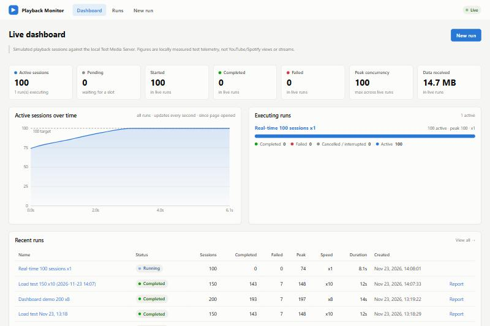

# Streaming Automation – API (backend)

Runs, monitors and reports on 100+ simulated playback sessions at once. ASP.NET Core 10, PostgreSQL, EF Core and SignalR.
The dashboard is a separate repository: **[streaming-app](https://github.com/VaibhavSontakke-Dev/streaming-app)** (React + TypeScript).



> **Simulated test data.** Sessions are modelled on YouTube but never contact YouTube or Spotify and create no views.
> They download synthetic media from the included Test Media Server. All figures are locally measured.

**Measured:** peaks of 100 (real time), 148, 496 and 986 concurrent sessions. See the [test report](docs/TEST-REPORT.md).
Other screenshots are in [docs/screenshots](docs/screenshots), and the raw results are in [docs/evidence](docs/evidence).

| Service | URL |
|---|---|
| API | http://localhost:5126 (docs at `/scalar`) |
| Test Media Server | http://localhost:5200 |
| PostgreSQL | localhost:5432 |

## Prerequisites

- .NET SDK 10
- PostgreSQL 18, running, with a user allowed to create databases (for example `postgres`)
- Windows PowerShell 5.1 or later (for the scripts)

## Setup (once)

Run every command from this folder in PowerShell.

**1. Build**

```powershell
dotnet tool restore
dotnet build StreamingAutomation.slnx
```

**2. Save the database password.** It is kept outside the code, in .NET user-secrets.

```powershell
dotnet user-secrets set "ConnectionStrings:Default" "Host=localhost;Port=5432;Database=streaming_automation;Username=postgres;Password=<your-password>" --project StreamingAutomation.API
```

In Visual Studio you can instead right-click `StreamingAutomation.API` → **Manage User Secrets**.

The API creates the database and tables when it starts.

## Run

Use two terminals. Start the Media Server first.

```powershell
dotnet run --project StreamingAutomation.MediaServer --launch-profile http
```

```powershell
dotnet run --project StreamingAutomation.API --launch-profile http
```

Check that http://localhost:5126/health shows `Healthy`. Then start the
[dashboard](https://github.com/VaibhavSontakke-Dev/streaming-app).

**One command:** this starts both services. It also starts the dashboard if that repository is cloned next to this one
(as `streaming-app` or `streaming-web`).

```powershell
powershell -ExecutionPolicy Bypass -File .\scripts\start-all.ps1
```

**Visual Studio:** open `StreamingAutomation.slnx`, set `StreamingAutomation.MediaServer` and `StreamingAutomation.API`
as multiple startup projects, and press F5.

## Test

```powershell
dotnet test StreamingAutomation.slnx
```

The integration tests drop and recreate their own database, `streaming_automation_tests`. Your data is not touched.

Load test for 100+ sessions (needs both services running; saves results in `docs/evidence`):

```powershell
powershell -ExecutionPolicy Bypass -File .\scripts\run-load-test.ps1
```

## Configuration and environment variables

Settings are in each project's `appsettings.json`. Override them with environment variables. The example file is
[`.env.example`](.env.example). No passwords are stored in this repository.

| Variable | Default | Purpose |
|---|---|---|
| `ConnectionStrings__Default` | – (required) | PostgreSQL connection |
| `Database__ApplyMigrationsOnStartup` | `true` | Create or update tables on start |
| `Cors__AllowedOrigins__0` | `http://localhost:5173` | Browser address allowed to call the API |
| `MediaClient__BaseUrl` | `http://localhost:5200` | Test Media Server address |
| `MediaClient__MaxRetryAttempts` | `3` | Retries per download |
| `Playback__MaxSessionsPerRun` | `1000` | Largest allowed run |
| `Playback__MaxGlobalConcurrency` | `1000` | Most sessions at once on this host |
| `Playback__StallTimeoutSeconds` | `45` | Time without a heartbeat before a session fails |
| `MediaServer__TransientErrorRate` | `0.01` | Share of requests given a temporary error |

## Common problems

| Problem | Fix |
|---|---|
| `No password has been provided` | Repeat setup step 2 from Visual Studio or a normal PowerShell window |
| `password authentication failed` | The saved password is wrong |
| Sessions fail with `MEDIA_NETWORK_ERROR` | Start the Test Media Server |
| Build says a file is locked | Stop the running API, then build again |

## Documentation and resources

- [Architecture and trade-offs](docs/ARCHITECTURE.md) and [test report with limitations](docs/TEST-REPORT.md)
- Platform terms: [YouTube](https://www.youtube.com/t/terms), [YouTube API](https://developers.google.com/youtube/terms/api-services-terms-of-service), [Spotify](https://developer.spotify.com/terms)
- [ASP.NET Core](https://learn.microsoft.com/aspnet/core), [EF Core](https://learn.microsoft.com/ef/core/), [Npgsql](https://www.npgsql.org/efcore/), [EFCore.NamingConventions](https://github.com/efcore/EFCore.NamingConventions), [PostgreSQL](https://www.postgresql.org/docs/18/), [SignalR](https://learn.microsoft.com/aspnet/core/signalr/introduction)
- [HTTP resilience (Polly)](https://learn.microsoft.com/dotnet/core/resilience/http-resilience), [FluentValidation](https://docs.fluentvalidation.net/), [Serilog](https://serilog.net/), [Scalar](https://github.com/scalar/scalar), [xUnit](https://xunit.net/)
