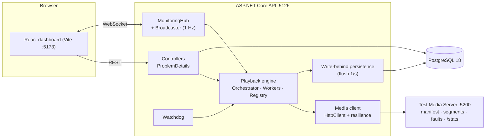
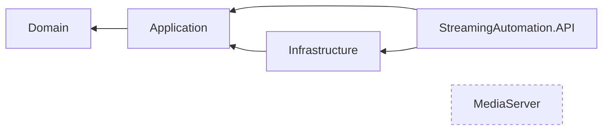
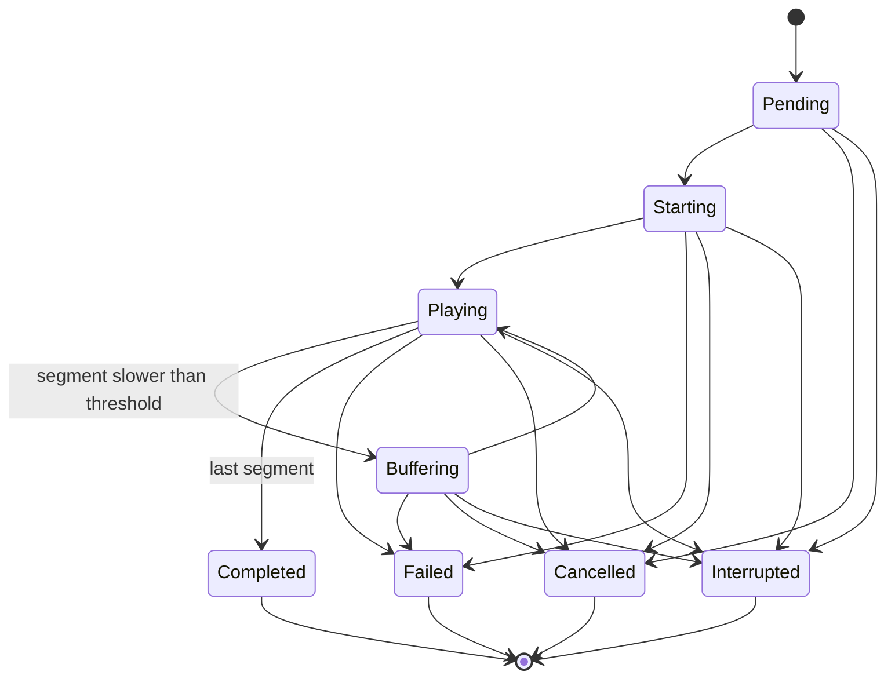
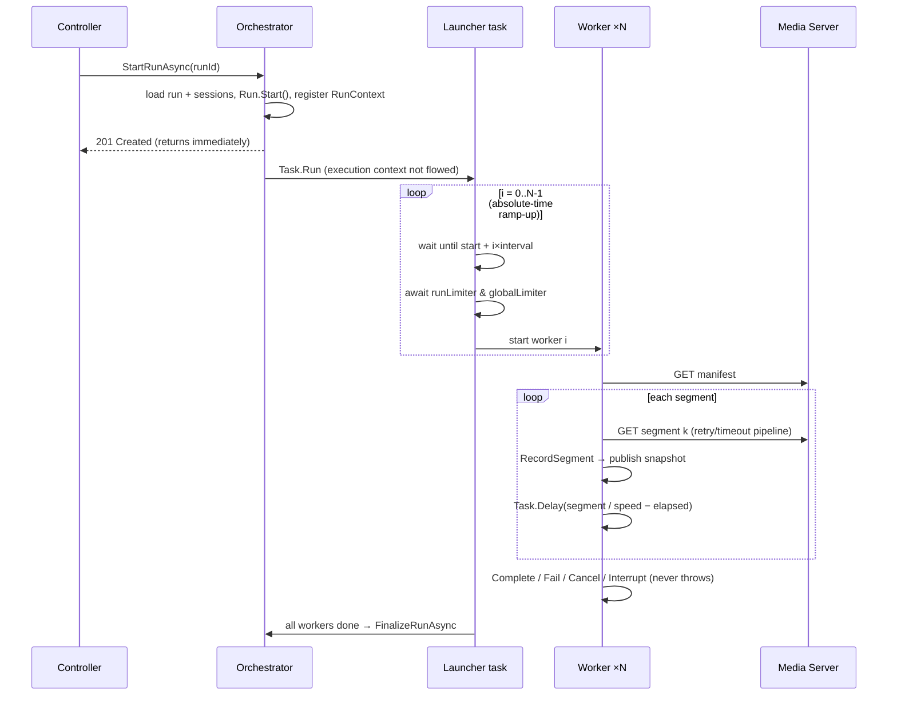

# Architecture

This document explains how the prototype is built and why: the concurrency model, persistence, real-time delivery,
resilience, and the trade-offs behind each decision. It is written to support the technical interview walkthrough.

- [1. System overview](#1-system-overview)
- [2. Solution layout & dependency rule](#2-solution-layout--dependency-rule)
- [3. Domain model & session state machine](#3-domain-model--session-state-machine)
- [4. Concurrency model](#4-concurrency-model)
- [5. Persistence: write-behind, single writer, set-based SQL](#5-persistence-write-behind-single-writer-set-based-sql)
- [6. Real-time monitoring (SignalR)](#6-real-time-monitoring-signalr)
- [7. Resilience & error handling](#7-resilience--error-handling)
- [8. Test Media Server & fault injection](#8-test-media-server--fault-injection)
- [9. Observability](#9-observability)
- [10. Frontend](#10-frontend)
- [11. Testing strategy](#11-testing-strategy)
- [12. Key decisions & trade-offs](#12-key-decisions--trade-offs)
- [13. Defects found by testing (and fixed)](#13-defects-found-by-testing-and-fixed)
- [14. Scaling beyond one node](#14-scaling-beyond-one-node)

---

## 1. System overview

A **test run** asks for *N* sessions with a concurrency limit, ramp-up, playback speed and simulated failure rate.
The engine starts one asynchronous worker per session. Each worker:

1. fetches the media manifest;
2. downloads 2-second segments over HTTP;
3. paces itself in real time, scaled by the playback speed;
4. reports progress after every segment.

The dashboard watches all of this live, and the report summarises it afterwards. The Test Media Server is a separate
process. It acts as the controlled stand-in for a streaming platform's media delivery and **measures stream
concurrency independently** of the engine.

## 2. Solution layout & dependency rule

| Project | Responsibility | Depends on |
|---|---|---|
| **Domain** | `TestRun`, `PlaybackSession`, `SessionEvent`, `MediaItem`; the `SessionStateMachine` transition table; domain exceptions | nothing |
| **Application** | Use cases (`TestRunService`, `RunQueries`, `ReportService`), the playback engine, the live monitor, ports (`IApplicationDbContext`, `IMediaStreamClient`, `IPlaybackStateWriter`), validation, options | Domain, EF Core abstractions |
| **Infrastructure** | `AppDbContext` and migrations (Npgsql, snake_case), `PlaybackStateWriter` (set-based SQL), `MediaStreamClient` with its resilience pipeline | Application |
| **API** | Controllers, exception-to-problem-details mapping, SignalR hub and broadcaster, hosting, OpenAPI | Application, Infrastructure |
| **MediaServer** | Independent test server (no shared code with the API) | – |

**On exposing `DbSet<T>` through `IApplicationDbContext`.** EF Core already *is* a unit of work plus repository, so
hand-written repositories would add code without adding isolation. The Application layer still does not know about
Npgsql or SQL. The one hot path that needs provider-specific SQL (bulk session updates) sits behind its own port,
`IPlaybackStateWriter`.

## 3. Domain model & session state machine

* All transitions are declared in **one table**, `SessionStateMachine`. Entities refuse illegal transitions with
  `InvalidStateTransitionException`, which the API maps to 409. This is unit-tested as a table.
* `Interrupted` means the *host* stopped (shutdown or crash). It is kept distinct from `Cancelled` (a user request) and
  `Failed` (a media or stall error), so the counts stay honest.
* Each status change also appends a `SessionEvent` (an audit trail), which feeds the session timeline in the UI.

## 4. Concurrency model

**Key points**

* **One task per session, not one thread per session.** Workers are I/O-bound `async` methods, so 1,000 sessions run
  on a handful of thread-pool threads: the test report's sampled maximum is 13. That is what makes 1,000 sessions
  possible on a 2-core laptop.
* **Two semaphores.** `runLimiter` enforces the run's `MaxConcurrency` (tested: the peak equals the limit exactly).
  `globalLimiter` (`Playback:MaxGlobalConcurrency`) protects the host across runs.
* **Single owner per session.** Only the session's worker mutates its `PlaybackSession` entity; before launch, only the
  launcher does. Every mutation publishes an immutable **`SessionSnapshot`** to the run's `RunContext`. The
  watchdog, the persistence flusher, the REST queries and the SignalR broadcaster only *read* snapshots. The hot
  path therefore needs no locks, and readers never see a half-updated session.
* **Lock-free counters.** `RunContext` keeps the started, active, peak, completed and other counts with
  `Interlocked`, updated on status transitions. Peak concurrency uses a compare-exchange max loop.
* **Absolute-time ramp-up.** Session *i* starts at `t0 + i × (ramp / (N − 1))`. When the coarse OS timer
  (about 15.6 ms on Windows) wakes up late, overdue sessions start back-to-back. A naive `Task.Delay(interval)` per
  session made a 10-second ramp take about 17 seconds at 1,000 sessions (see §13).
* **Real-time pacing and buffering.** A segment represents `segmentDuration / speed` of wall time. If a download,
  including any retries, takes longer than `max(segment play time, 500 ms)`, the session shows **Buffering** until the
  data arrives. This is what a viewer would experience.
* **Cancellation with a reason.** A `CancellationTokenSource` per run, plus a linked one per session. The reason
  (`User`, `Stalled`, `Shutdown`) decides the terminal status. If a session was asked to stop, the stop reason wins
  whatever exception the transport reported.
* **The request's execution context is not flowed into runs.** Runs outlive the HTTP request that started them.
  Suppressing `ExecutionContext` flow keeps request log scopes and trace IDs from leaking into background sessions.

## 5. Persistence: write-behind, single writer, set-based SQL

Writing to PostgreSQL on every segment would cost 1,000 sessions × 2.5 segments per second = 2,500 row updates per
second, plus round trips. Instead:

1. Workers **never touch the database**. Publishing a snapshot marks the session *dirty* in its `RunContext`;
   status changes enqueue a `SessionEvent`.
2. `PersistenceFlushService` runs every `FlushIntervalMs` (1 s). It collects all dirty sessions across runs (each
   session's *latest* snapshot only, so any number of updates collapse into one) and calls `IPlaybackStateWriter`.
3. `PlaybackStateWriter` performs **one** `UPDATE playback_sessions … FROM unnest(@ids, @statuses, …)` statement for
   all dirty sessions, a batched insert of events, and counter updates per run, **in one transaction**. The session update is a
   single statement whether there are 10 sessions or 1,000.
4. **Single writer.** Periodic flushes and the final flush at the end of a run share one `SemaphoreSlim`, so a stale
   snapshot can never overwrite a newer one.
5. **Failure handling.** If a write fails, the sessions are marked dirty again and the events are re-queued for the
   next tick. Npgsql's execution strategy retries transient errors. State still in memory is lost if the process crashes.
   This path has no automated test.
6. **Run finalisation.** The final state of every session is written, then the run's terminal status is applied
   *through the domain model* (`Run.Complete()` and so on), and the run leaves the registry.
7. **Crash recovery.** On start-up, `PlaybackLifecycleService` marks any runs or sessions left non-terminal by a
   previous process as `Interrupted`. On shutdown, active runs are interrupted and flushed. Hosted services stop in
   reverse registration order, so the flusher goes last.

**Trade-off.** The database lags the in-memory truth by up to one flush interval. That is why the REST queries serve
**live runs from memory** and finished runs from PostgreSQL.

## 6. Real-time monitoring (SignalR)

* **Hub** `/hubs/monitoring`, strongly typed through `Hub<IMonitoringClient>`.
* **Throttled push.** `MonitoringBroadcaster` ticks every `BroadcastIntervalMs` (1 s):
  - `OverviewUpdated` goes to all clients: one message describing every active run.
  - `RunUpdated` goes to the `run:{id}` group: counters plus **only the sessions that changed** since the last tick.
    Snapshots are immutable, so the diff is a cheap reference comparison.

  At 1,000 sessions and about 2,500 events per second, each client still receives **one overview and one run message
  per tick**. An integration test asserts the message bound with 30 sessions. The message rate is constant, but each
  message grows with the number of changed sessions.
* **Subscribe protocol.** `SubscribeToRun` returns the full current state, then deltas follow. On the client, a delta
  that races ahead of the subscribe result is reconciled with a "newer snapshot wins" rule.
* **End of run.** Session changes made between the last tick and finalisation are flushed as a final `RunUpdated`
  before `RunFinished`. A test caught this gap (§13). Clients then re-fetch the final state over REST.
* **Reconnects.** The client reconnects automatically with back-off and re-subscribes. Without a live connection, the
  pages fall back to REST.
* Enums travel as strings on every channel: MVC, minimal APIs, SignalR and OpenAPI.

## 7. Resilience & error handling

**Media client pipeline** (`Microsoft.Extensions.Http.Resilience`, i.e. Polly v8), outermost first:

| Layer | Setting | Why |
|---|---|---|
| Total timeout | 30 s | bounds one logical request, including every retry |
| Retry | 3 attempts, exponential back-off from 200 ms **with jitter** | handles 5xx, 408, 429, timeouts and network errors. Jitter prevents synchronised retry storms across hundreds of sessions. |
| Attempt timeout | 5 s | a hung connection fails fast and gets retried |

* **No circuit breaker, deliberately.** All sessions share one client. A breaker tripped by the few *deliberately
  broken* streams would fail every healthy session as well. A per-session breaker adds little value when each
  session retries at most 3 times.
* Retries are counted per session: the pipeline's `OnRetry` increments a counter carried in `HttpRequestMessage.Options`.
* Final failures become error codes: `STREAM_BROKEN`, `TRANSIENT_UNAVAILABLE`, `MEDIA_TIMEOUT`,
  `MEDIA_NETWORK_ERROR`, `MEDIA_HTTP_<status>`, `SESSION_STALLED` (watchdog) and `UNEXPECTED_ERROR`.
* **Workers are designed not to throw.** Every expected outcome ends in a terminal status, so one bad session does not
  take down a run.
* **The watchdog** cancels active sessions whose heartbeat is older than `StallTimeoutSeconds` and marks them failed. It
  is a safety net behind the request timeouts, and it has no automated test.

**HTTP API.** `ApiExceptionHandler` turns exceptions into RFC 9457 problem details, each with a `traceId`:

| Exception | Status |
|---|---|
| `ValidationException` (FluentValidation) | 400, with a per-field `errors` dictionary |
| `NotFoundException` | 404 |
| `DomainException` / `InvalidStateTransitionException` | 409 (e.g. cancelling a finished run) |
| client aborted the request | 499, no body |
| anything else | 500, logged, no internals leaked |

## 8. Test Media Server & fault injection

* `GET /media/{key}/manifest` returns the duration, segment count, segment size (128 kbps × 2 s = 32 KB) and bitrate.
* `GET /media/{key}/segments/{i}` returns real bytes from a shared, pre-generated buffer (no allocation per request),
  after a configurable latency with jitter.
* **Transient faults.** A random 503 with probability `TransientErrorRate` (1% by default). Clients recover by retrying.
* **Broken streams, which are deterministic.** The run's failure rate is sent as `X-Session-Fail-Rate`. The server
  hashes `X-Session-Id` (SHA-256) to decide whether *this* session's stream breaks, and at which segment (never the
  first). The same session ID always gives the same result, so the count is **exactly predictable from the IDs**, and the
  150-session integration test asserts it. IDs are new for every run, so the count **varies from run to run**.
* **Independent telemetry** at `/stats`: active streams, peak concurrent streams, bytes served, and faults injected.
  A stream is active from its first request until it receives its final segment, or until it has been idle for
  10 seconds (failed streams), so it can read slightly high. It is measured in a separate process, which makes it the
  independent check on the engine's own count.

## 9. Observability

* **Serilog** structured logs. Session log lines carry `RunId` and `SessionId` scopes. A session failure is logged
  once, at Warning, with its error code. Polly's per-attempt logs are muted (they would report *injected* faults as
  errors).
* `/health` checks PostgreSQL. `/api/system/stats` reports active runs and sessions, persistence flushes, rows written,
  working set, managed heap, thread-pool threads and CPU time.
* A `session_events` audit trail records every status change of every session.
* `run-load-test.ps1` samples engine counters and process telemetry once per second into `samples.csv`.

## 10. Frontend

* **React 19 + TypeScript (strict) + Vite.** Pages are lazy-loaded per route.
* **Server state with TanStack Query** (caching, polling while a run is running, invalidation when `RunFinished`
  arrives). **Live state** comes through one shared SignalR connection (`SignalRProvider`) and two hooks,
  `useOverview` and `useLiveRun`.
* **Virtualised session table** (`@tanstack/react-virtual`, fixed 44 px rows). Only the visible rows plus overscan are
  in the DOM: 23 of 150 were measured in the browser, and a test checks 1,000.
* **Charts** (Recharts): one series (active sessions), a 2 px line, a recessive grid, a crosshair tooltip and a dashed
  **100 target** reference line. Status colours are reserved for status and always appear with a text label. Light and
  dark themes are each selected palettes, not an automatic colour inversion.
* **Validation.** Client-side validation mirrors the server's rules. Server 400 `errors` are mapped back onto the
  matching form fields.

## 11. Testing strategy

| Level | What | Count |
|---|---|---|
| Domain unit | state-machine table, entity invariants, run lifecycle | 23 |
| Infrastructure unit | EF model matches the migrations; seed catalogue | 2 |
| Media server unit | fault-injector determinism and ratio; stream statistics | 7 |
| Integration: media | real client ↔ in-memory media server: retries counted, 404 not retried, broken stream, cancellation, 150 parallel streams | 7 |
| Integration: engine | real API + PostgreSQL test DB: **150 concurrent sessions with an exact failure count**, cancel run, cancel session, crash recovery | 4 |
| Integration: HTTP | 400/404/409/201/202, filters, paging, sorting, JSON and CSV report, OpenAPI document, system stats | 6 |
| Integration: SignalR | initial state, **throttled deltas** (message-count bound), final delta, finish notice | 2 |
| Frontend | formatting, delta merging, race resolution, form validation, **virtualisation window**, cancel button | 10 |
| End-to-end evidence | `scripts/run-load-test.ps1` at 100 / 150 / 500 / 1,000 sessions | see the test report |

Integration tests run with collection parallelism off, so the timing-sensitive engine tests don't compete with each
other. An 11-test version passed 6 consecutive rounds, and the current 19-test suite passed 3.

## 12. Key decisions & trade-offs

| Decision | Alternatives | Why |
|---|---|---|
| Local Test Media Server instead of the real YouTube/Spotify | headless browsers on the real platform | Our choice for meeting the brief's integrity rules, which allow an authorised test environment. Delivery is measurable and faults can be injected. The trade-off is that no real platform playback is exercised. |
| Async task per session | thread per session; actor framework | I/O-bound work. 1,000 sessions ran on at most 13 sampled thread-pool threads. Simple to reason about. |
| Immutable snapshots plus a single owner | locks around shared entities | No contention on the hot path; readers always see consistent data. |
| Write-behind, set-based flush | write per event | One session update statement per flush, whatever the concurrency. Costs about 1 s of database lag, which REST hides by serving live runs from memory. |
| Throttled delta broadcast | push every event | A constant message rate as concurrency grows. |
| No circuit breaker | shared breaker | A shared breaker would turn injected faults in some sessions into outages for all of them. |
| Hash-based fault injection | random failures | Failures are predictable from the session IDs, so tests can assert exact counts. Counts still differ between runs because IDs are new. |
| `DbSet` behind `IApplicationDbContext` | custom repositories | EF Core is already a unit of work plus repository. A dedicated port is kept for the one provider-specific hot path. |
| In-process engine state | distributed queue (e.g. Redis or Service Bus) | Right-sized for a single-node prototype. The scaling path is described below. |

## 13. Defects found by testing (and fixed)

| Symptom | Root cause | Fix |
|---|---|---|
| A cancel-run test failed intermittently (30 sessions counted as cancelled instead of 40) | Likely: an aborted request can surface as `HttpRequestException`/`IOException`, not as `OperationCanceledException` (inferred; no recurrence since the fix) | If the session's token was cancelled, the stop reason wins regardless of the exception type (`SessionWorker`). |
| The dashboard missed the final session states | A run was removed from the registry before the next broadcast tick | The registry keeps finished runs briefly; the monitor sends a final delta, then `RunFinished`. |
| Background session logs carried `RequestPath=/api/runs` | `Task.Run` flowed the HTTP request's `ExecutionContext` | `ExecutionContext.SuppressFlow()` around launching the run. |
| 1,000 sessions peaked at 696 when about 1,000 were expected | Ramp-up via `Task.Delay(10 ms)` per session was stretched by the 15.6 ms OS timer (10 s became about 17 s) | Absolute-time ramp scheduling (§4). The peak became **986**. |
| The media server over-counted concurrency for short sessions | Its activity window treated finished streams as active for 10 s | A stream ends when its final segment is served. |

## 14. Scaling beyond one node

The prototype is deliberately single-node. To scale out:

1. **Work distribution.** Replace the in-process launcher with a queue (for example Azure Service Bus, RabbitMQ or
   PostgreSQL `SKIP LOCKED`). Workers on several nodes claim sessions, with a lease and heartbeat per session.
2. **Live state.** Move `RunContext` counters to Redis (atomic increments) or aggregate per node and merge.
3. **Real time.** Add a SignalR backplane (Redis), or use Azure SignalR Service.
4. **Persistence.** The set-based writer already scales; use partitioning or time-based retention for `session_events`.
5. **Load generation.** For external targets, generate load from several machines so that one NIC or CPU is not the
   bottleneck.
