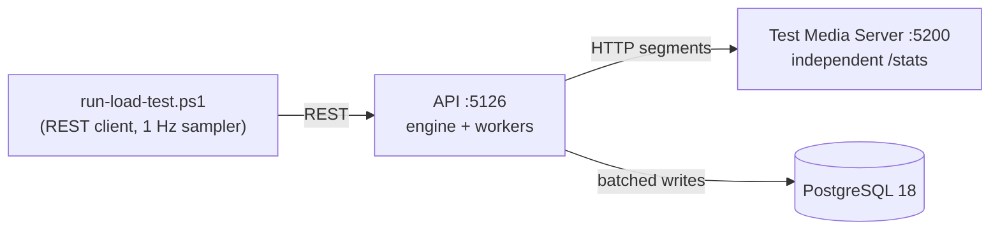

# Test Report – Concurrent Playback Sessions

**Verdict: PASS.** The prototype orchestrated and monitored **100 concurrent sessions in real time (×1)**,
**150 at ×10 (peak 148)**, **500 at ×5 (peak 496)** and **1,000 at ×5 (peak 986)**. Every one of the 1,750 sessions
was accounted for. Peak concurrency was measured by two separate processes: the engine's live counter, and the Test
Media Server's own count of streams. A third figure, rebuilt from the saved session timestamps, checks that the stored
data matches the engine. It is not independent, because the engine wrote those timestamps.

> **Data source.** These are simulated playback sessions, measured locally against the bundled Test Media Server (an
> authorised, controlled test environment). They are **not** views, streams or listeners reported by YouTube or
> Spotify, and no requests were sent to either platform.

## 1. Test setup



| Component | Configuration |
|---|---|
| Media | Test Media 01, 60 s → 30 segments of 2 s × 32 KB (128 kbps) |
| Media server | 15 ms base latency + 0–35 ms jitter; **1% transient 503s**; broken streams per the run's failure rate (decided by a hash of the session ID) |
| Media client | 5 s attempt timeout, 30 s total, 3 retries with exponential back-off and jitter |
| Engine | global concurrency limit 1,000; DB flush every 1 s; SignalR broadcast every 1 s; watchdog 45 s |
| Build | `dotnet run` (Debug build, Development environment); API and media server in separate processes. Release builds were not measured. |

### Machine / environment

| | |
|---|---|
| CPU | Intel Core i3-1115G4 @ 3.00 GHz, **2 cores / 4 threads** |
| Memory | 15.7 GB |
| OS | Windows 11 Home 10.0.26200 |
| Runtime | .NET SDK 10.0.403 (runtime 10.0.14), Node 24.22.1 |
| Database | PostgreSQL 18 (local service, port 5432) |
| Topology | **Everything on one laptop**: load generator, API, media server, database and (during screenshots) the browser |

## 2. Procedure (repeatable)

1. Start the three services (`scripts/start-all.ps1`, or the commands in the [README](../README.md)).
2. Run `scripts/run-load-test.ps1` with the parameters below. The script:
   - checks `/health` on both services and resets the media server's telemetry;
   - starts the run with `POST /api/runs`;
   - samples `GET /api/runs/{id}`, `GET /api/system/stats` and `:5200/stats` every second into `samples.csv`;
   - downloads `run.json`, `report.json`, `report.csv` and the media server statistics;
   - asserts the acceptance criteria and writes `summary.md`. The exit code is non-zero on any failure.
3. Evidence for each run is in `docs/evidence/<timestamp>-<n>-sessions/`.

### Acceptance criteria (asserted by the script)

1. The run reaches `Completed`.
2. `started = requested`.
3. completed + failed + cancelled + interrupted = requested (no session is lost).
4. Engine peak concurrency ≥ 100.
5. Peak reconstructed from persisted session start and end timestamps ≥ 100 (a consistency check, not an independent measurement).
6. **Media server's own peak of concurrent streams ≥ 100**, measured in a separate process.
7. Bytes received by the engine ≤ bytes served by the media server (and > 0).

## 3. Results

| Scenario | Command | Sessions | Peak (engine / DB / media server) | Completed | Failed | Duration | Result |
|---|---|---|---|---|---|---|---|
| **Real time** | `-Sessions 100 -PlaybackSpeed 1 -RampUpSeconds 10 -FailureRate 0.02` | 100 | **100 / 100 / 100** | 99 | 1 | 68.3 s | PASS |
| Standard | `-Sessions 150 -PlaybackSpeed 10 -RampUpSeconds 5` | 150 | **148 / 148 / 150** | 139 | 11 | 11.1 s | PASS |
| Stress | `-Sessions 500 -PlaybackSpeed 5 -RampUpSeconds 5` | 500 | **496 / 496 / 500** | 477 | 23 | 17.1 s | PASS |
| Stress | `-Sessions 1000 -PlaybackSpeed 5 -RampUpSeconds 10` | 1,000 | **986 / 986 / 1,000** | 953 | 47 | 22.3 s | PASS |

Failed sessions are the **intended** broken streams (failure rate 5%, or 2% for real time). Every failure carries the
error code `STREAM_BROKEN`. No session failed for any other reason: no timeouts, no stalls, no unexpected errors.

**Failure counts vary between runs.** Each run creates new session IDs, and a hash of the ID decides whether that stream
breaks. The rate is therefore approximate (for example 11 of 150, or 7.3%, for a 5% setting). Given the IDs, the result
is exactly predictable, which is how the integration test can assert the exact count.

### Detailed metrics

| Metric | 100 ×1 | 150 ×10 | 500 ×5 | 1,000 ×5 |
|---|---|---|---|---|
| Success rate (completed / started) | 99.0% | 92.7% | 95.4% | 95.3% |
| Data received | 91.1 MB | 132.8 MB | 445.2 MB | 895.5 MB |
| Segments downloaded | 2,986 | 4,353 | 14,587 | 29,343 |
| Aggregate throughput | 11.2 Mbps | 100.4 Mbps | 218.4 Mbps | 336.9 Mbps |
| Transient faults injected → retries (sessions retried) | 42 → 45 (38) | 38 → 71 (41) | 138 → 207 (143) | 272 → 413 (277) |
| Session wall time p50 / p95 (completed) | 58.2 / 58.3 s | 6.0 / 6.2 s | 11.9 / 11.9 s | 11.9 / 12.0 s |
| Startup latency (start → playing) p50 / p95 | 41 / 58 ms | 40 / 58 ms | 41 / 59 ms | 42 / 65 ms |
| API peak working set | 227 MB | 225 MB | 223 MB | 220 MB |
| API max thread-pool threads | 7 | 7 | 6 | 13 |

The retry counts are larger than the number of transient faults because the broken streams are also retried before
they fail (3 attempts each).

### Observations

* **The engine and the media server agree** within 0–14 sessions. The database figure matches the engine's exactly, as
  expected, because it is rebuilt from timestamps the engine wrote. The media server's figure is slightly higher. The
  likely reason is that a failed stream stays "active" there until its 10-second idle window expires.
* **Startup latency stayed flat in these runs**: p95 was 58–65 ms from 100 to 1,000 sessions. Completed sessions took
  close to their expected time (for example 58.2 s for a 60 s clip at ×1). The figure is slightly under 60 s because
  the engine does not wait after downloading the last 2-second segment.
* **Resource use stayed small.** The API's working set was about 220 MB in all four runs. The sampled maximum was 6–7
  thread-pool threads up to 500 sessions and 13 at 1,000: one task per session, not one thread.
* **Few database statements, by design.** All changed sessions are saved by one set-based `UPDATE … FROM unnest(...)`
  per flush (about once a second), plus the run counters and audit events. The number of rows per flush still grows
  with concurrency. Database load itself was not measured.
* **Retries do their job.** About 1% of requests got a 503, and none of those sessions failed because of it.

## 4. Automated test suite

| Suite | Result |
|---|---|
| Backend unit tests (xUnit) | **32 / 32 passed** |
| Backend integration tests (real API + PostgreSQL + in-memory media server) | **19 / 19 passed**, including a 150-concurrent-session run with an exactly predicted failure count, SignalR throttling, and the 200/201/202/400/404/409 responses |
| Frontend tests (Vitest + Testing Library) | **10 / 10 passed**, including the session table rendering at most 21 of 1,000 rows |
| Type-check + production build (`tsc -b && vite build`) | clean |
| Stability | The 19-test integration suite passed 3 consecutive rounds on 23 November, before the last three fixes in section 5, and every full run since. An earlier 11-test version passed 6 consecutive rounds. |

```powershell
dotnet test StreamingAutomation.slnx
npm test        # run in the streaming-app (dashboard) repository
```

## 5. Issues found during testing and fixed

| Found by | Issue | Fix |
|---|---|---|
| Repeated integration runs | The cancel test failed intermittently: 30 sessions were counted as cancelled instead of 40. The likely cause is that an aborted download can surface as a network error rather than a cancellation. The failure has not recurred since the fix. | The stop reason wins over the exception type. |
| SignalR test | The final session states were never broadcast before the run was removed | Final delta, then `RunFinished`. |
| Live smoke test (logs) | Session logs inherited the HTTP request's scope | Execution context is no longer flowed into runs. |
| **1,000-session load test** | Peak was only 696, because the ramp-up stretched from 10 s to about 17 s (15.6 ms Windows timer) | Absolute-time ramp scheduling. The peak became **986**. |
| 500/1,000 load tests | Media-server concurrency over-counted short sessions | A stream ends when its final segment is served. |

Evidence for the runs made before these fixes was discarded. All results above come from runs made after them.

**Screenshots.** The images in `docs/screenshots` were taken on 23 November, before the last two fixes. They show the
user interface, which did not change, but they come from different runs than the results in section 3, so their
numbers differ from that table.

## 6. Limitations

* **Simulated playback.** Sessions download real bytes over HTTP and are paced in real time, but they do not decode
  or render video. The prototype measures orchestration and delivery workloads, not a real player's CPU/GPU cost.
* **Single machine.** Load generator, API, media server and database share a 2-core laptop, so the absolute
  throughput figures describe this setup only. Scaling beyond 1,000 sessions was not measured. 1,000 sessions per run is the configured validation limit (`Playback:MaxSessionsPerRun`), not a
  measured ceiling.
* **Accelerated time.** The 150/500/1,000 runs use ×5 or ×10 speed to keep test runs short. Real-time behaviour is
  covered by the ×1 run with 100 sessions.
* **The media server's activity window.** A failed stream counts as active for up to 10 seconds after its last
  request, so the media server's figure can read slightly high.
* **Single node.** The engine's state lives in process memory. Restarting the API interrupts active runs; crash
  recovery marks them `Interrupted`, and they are not resumed. Horizontal scaling needs a distributed queue and a
  SignalR backplane (see `ARCHITECTURE.md` §14).
* **Platform.** Sessions are modelled on YouTube but never play content from it. The brief's section 3 allows an
  authorised test environment; whether this satisfies its platform choice is the panel's decision.
* **Implemented but without an automated test:** the stall watchdog, graceful shutdown of active runs, and retrying
  failed database writes.
* **Not tested here:** a long soak test (hours), network partitions between the services, and PostgreSQL failover.
  Database write failures are handled by retrying with the in-memory state preserved, but they were not
  fault-injected in these runs.
* **No authentication or authorisation.** It is a local test tool.

## 7. Evidence index

| Folder | Scenario |
|---|---|
| [`docs/evidence/20261123-141644-100-sessions`](evidence/20261123-141644-100-sessions/summary.md) | 100 sessions, real time ×1 |
| [`docs/evidence/20261123-141628-150-sessions`](evidence/20261123-141628-150-sessions/summary.md) | 150 sessions, ×10 |
| [`docs/evidence/20261123-141758-500-sessions`](evidence/20261123-141758-500-sessions/summary.md) | 500 sessions, ×5 |
| [`docs/evidence/20261123-141545-1000-sessions`](evidence/20261123-141545-1000-sessions/summary.md) | 1,000 sessions, ×5 |
| [`docs/screenshots/`](screenshots/) | Dashboard, run detail, session table, session timeline, report, form, run list |
